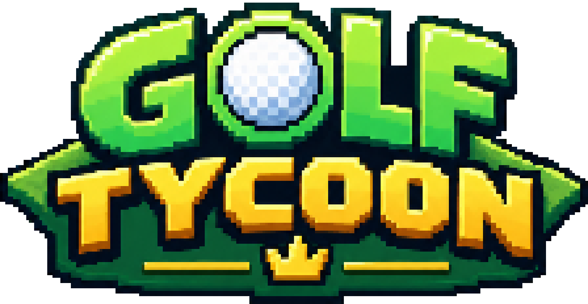
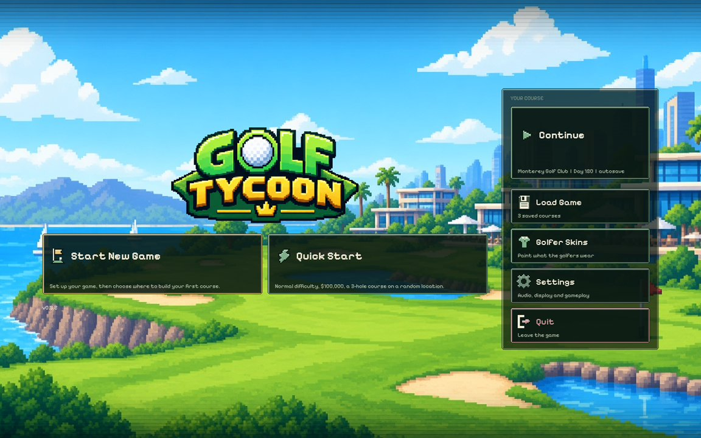
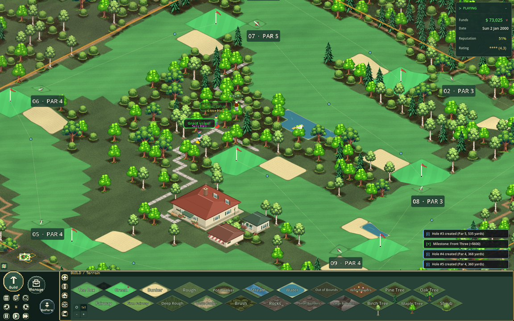
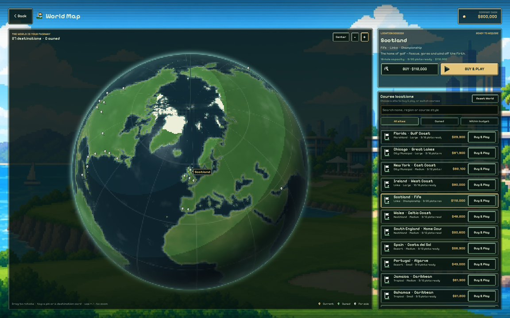
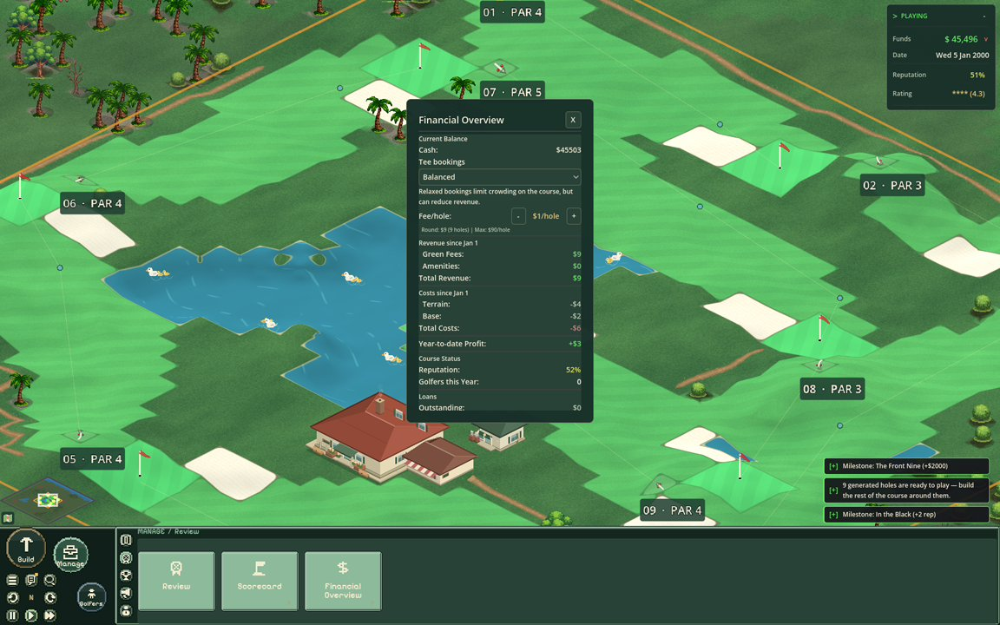
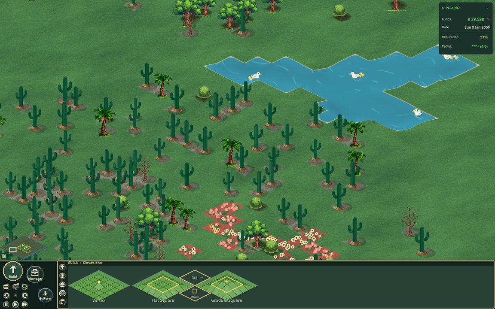

<p align="center">
  
</p>

<p align="center">
  <a href="LICENSE"></a>
  <a href="https://godotengine.org"></a>
  <a href="project.godot"></a>
</p>

Build a golf course from the ground up, then run it as a business. Lay out tees, greens and bunkers, place buildings and decorations, hire staff, and watch golfers play your holes shot by shot.

Golf Tycoon is a 2D isometric simulation written in **GDScript** for **Godot 4.6**.

---

## Contents

- [Features](#features)
- [Screenshots](#screenshots)
- [Quick Start](#quick-start)
- [Controls](#controls)
- [Project Structure](#project-structure)
- [Testing](#testing)
- [Documentation](#documentation)
- [Contributing](#contributing)
- [License](#license)

## Features

- **Course building.** Paint terrain such as fairways, bunkers, water, rough and trees. Create holes by painting a tee box and a cup, then open the hole.
- **Shot-by-shot golf.** Golfers choose targets, clubs and risks. Wind, lies, terrain and accuracy all affect every shot.
- **Real golfers.** Every golfer has a name, profession, marital status, age and gender, traits (Neat, Outgoing, Active, Playful, Nice), skills (Length, Accuracy, Imagination), ten point-based Golf Skills (Power Hitter through Luck, each +10% per point up to 990%), live statuses (Fun, Attitude, Energy, Hunger, Thirst) and a running record of their Positive, Neutral and Negative comments.
- **Ten themes.** Parkland, Desert, Links, Mountain, City, Resort, Heathland, Woodland, Tropical and Marshland each change the look, wind and costs.
- **Business management.** Set green fees, manage costs and loans, hire staff, and watch the daily accounts.
- **Star ratings.** Condition, design, value, pace and aesthetics combine into a five-star course rating that drives golfer demand.
- **Reputation and tournaments.** Host tournaments from local to championship level. Winning raises your reputation.
- **World map.** Buy course locations across 27 destinations, each with its own theme, land and price.
- **Milestones and achievements.** Course Location Milestones for every site and World Milestones for the company unlock again with each save; career Achievements stay unlocked forever between saves. Each track has its own fullscreen screen on the world map's backdrop.
- **Modding.** Install folder/ZIP mods, arrange an ordered load list, create data, gameplay, UI and environment mods, and scaffold a new one from the Mods screen. Includes three official environment mods, nine examples and a starter template. [Modding guide](docs/modding.md). Steam Workshop integration is optional and requires a configured GodotSteam build.
- **Living calendar.** Seasons, weather, wind and seasonal events change play throughout the year.
- **Golfer skins.** Paint and re-colour the golfers' clothing in the built-in studio.
- **Touch and desktop.** Responsive layout for small windows, touch screens and the web build.
- **Device benchmark.** From Main Menu Settings, **Run Benchmark** prepares a throwaway benchmark course and tours every fixed test course on it - preparation, frame pacing, the GPU fill rate and script throughput all measured - then read the result as a five-star device scorecard on the fullscreen **Past Results** screen: a frame-time oscilloscope, a GPU load ladder, a golf-graded scorecard and a local shelf of past runs to compare devices against. Nothing is uploaded, and no game in progress is ever the test scene.

## Screenshots

<p align="center">
  
  
</p>
<p align="center">
  
  
</p>
<p align="center">
  
  
</p>

## Quick Start

You need **Godot 4.6** or later.

```bash
git clone https://github.com/Antas500/Golf-Tycoon.git
cd Golf-Tycoon
make run          # launch the game
make editor       # open the project in the Godot editor
```

If Make cannot find Godot, set the path yourself:

```bash
make run GODOT=/path/to/Godot
```

To start a game, choose **Quick Start** on the main menu, or **Start New Game** to pick a company name, difficulty, starting money and a location. Full build and export notes are in [Building & Running](docs/development/building.md).

## Controls

Every screen works with a mouse, a keyboard, both together, a gamepad or a touchscreen. Menus and panels use focus: arrows or the D-pad move, `Enter`/`A` selects, `Esc`/`B` goes back, and `Tab`/`LB`/`RB` steps through controls. On the course a keyboard or controller moves an on-screen pointer, so painting, placing and aiming need no mouse.

**Every course control can be rebound.** Open **Settings → Controls**, click a keycap and press the key or controller button you want. A key already in use is taken from the other action (and swapped when that leaves it with nothing), `Backspace` unbinds, and each row's ↺ or **Reset All Controls** puts the defaults back. Bindings apply immediately, are saved to `user://settings.cfg` and show up in the `F1` shortcut sheet. Menu navigation (`Esc`, `Tab`, `Enter`, the arrows and `A`/`B`) stays fixed.

**Screen-edge panning** pans the course when the mouse pointer rests in a narrow strip at the edge of the window - handy for looking around without pressing a key. It stands down while the pointer is over a HUD panel, during a middle-mouse drag, and once the pointer leaves the window. To turn it off, use **Settings → Controls → Camera → Edge Panning**; the choice is saved with your preferences. The same card has the invert-scroll-zoom switch and the camera zoom limits.

To monitor performance, turn on **Settings → Display → FPS Counter**. Choose its position, text size and refresh interval; the live readout works over menus and the course, including while paused, and does not block input. The counter is off by default and its preferences are saved between sessions.

If the course runs slowly, **Settings → Display → Performance & Scale** has a graphics quality preset and the individual controls behind it: terrain rendering, grass, tree occlusion, water shimmer, wind flag outlines, prop and ball shadows, course wildlife, impact particle bursts, and the rates at which decoration, the camera and golfer coordination repaint. **Auto** picks Performance on phones, Web and smaller devices; **Performance** turns the decoration off or down, which is the cheapest way to speed up a busy course without changing how it plays. Changes apply at once and are saved. See [Graphics quality](docs/ui-and-controls.md#graphics-quality).

**Your data stays on this device, and you can delete it.** **Settings → Data** lists the saved courses, preferences, career records, benchmark reports and custom golfer skins stored here, with a delete button for each group and one **Delete All Player Data** action. Every deletion asks first; deleting the saved courses during a game closes the course, because there is nothing left to autosave into. Mods are left to the Mods screen, where they can be uninstalled safely. See [Save & Load](docs/save-and-load.md#deleting-player-data).

| Action | Keys, mouse and gamepad |
| --- | --- |
| Pan the camera | `W` `A` `S` `D`, middle-mouse drag, or the left stick |
| Move the pointer | Arrow keys, or the right stick |
| Click at the pointer | `Enter`, or `A` |
| Zoom | Mouse wheel, `[` and `]`, or `LT`/`RT` |
| Rotate the view | `Q` and `Shift+Q`, or `X`/`Y` |
| Pause or resume | `Space`, or `Start` |
| Save | `Ctrl+S` |
| Undo and redo | `Ctrl+Z` and `Ctrl+Shift+Z` |
| Cancel | `Esc`, right-click, or `B` |
| Focus the HUD | `Tab`, or the controller's View/Back button |
| Hotkey help | `F1` |

Touch uses taps, one-finger drags (pan, paint or scroll), two-finger drags (pan and pinch open or closed to zoom — on the course, the World Map globe and the Course Map) and two-finger taps (cancel). The full list is in [UI & Controls](docs/ui-and-controls.md).

## Project Structure

```
Golf-Tycoon/
├── addons/gut/              GUT unit-testing framework
├── assets/                  Sprites, the game theme and the logo
├── data/                    JSON: buildings, decorations, terrain, visiting golfers, skins
├── docs/                    Documentation (start at docs/README.md)
├── scenes/
│   ├── main/main.tscn       The main game scene
│   └── entities/golfer.tscn The golfer scene
├── scripts/
│   ├── autoload/            Global singletons (game state, saves, events, screen layout)
│   ├── course/              Hole routes, routing overlay, entity layer
│   ├── effects/             Particles and cosmetic effects
│   ├── entities/            Golfers, balls, buildings, staff
│   ├── main/                main.gd, the game controller
│   ├── managers/            Owners of live groups: golfers, land, staff, weeds, tournaments
│   ├── systems/             Rules and calculators: shots, weather, wind, ratings, economy
│   ├── terrain/             Course surface, grid, overlays and generation
│   ├── tools/               Course-building tools
│   ├── ui/                  Menus, panels and HUD
│   └── utils/               Shared helpers
├── shaders/                 Course, elevation, planet and foliage shaders
├── tests/
│   ├── unit/                Unit tests (test_*.gd)
│   ├── integration/         Flow tests that run through the game
│   └── harness/             Scenes for manual checks and simulations
├── tools/                   Godot tools: golfer skin generator and warning scanner
├── web/custom_shell.html    Web export shell
├── Makefile                 make run, editor, test, warnings
├── test.sh                  Runs the GUT unit tests
├── check-warnings.sh        Fails on GDScript warnings
├── gutconfig.json           GUT configuration
├── export_presets.cfg       Windows, macOS, Linux and Web export presets
└── project.godot            Godot project file
```

## Testing

```bash
make test       # unit tests (GUT): tests/unit/
make warnings   # fails if any project script has a GDScript warning
```

- **Unit tests** (`tests/unit/`) cover the rules and calculations: 79 test files.
- **Integration tests** (`tests/integration/`) run flows through `main.gd`, such as hole creation, tournaments and saves. There are 17 scripts.
- **Harnesses** (`tests/harness/`) are scenes for manual checks, simulations and previews. They include `ready_golf_harness`, `tournament_harness` and `sim_harness`.

Continuous integration runs the `unit` and `warnings` jobs. See [Testing](docs/development/testing.md) for the details.

## Documentation

- **[Documentation hub](docs/README.md)**: start here.
- **[Architecture](docs/architecture.md)**: how the project fits together.
- **[Systems index](docs/systems/README.md)**: every game system, with its rules and tuning values.
- **[Save & Load](docs/save-and-load.md)**, **[Data Reference](docs/data-reference.md)** and **[Golfer Skins](docs/golfer-skins.md)**.
- **[Contributing](docs/development/contributing.md)**: workflow, conventions and the documentation template.

## Contributing

Contributions are welcome. Read [Contributing](docs/development/contributing.md) first. Run `make test` and `make warnings` before you open a pull request, and update the docs for any system you change.

## License

Golf Tycoon is software released under the **GNU General Public License v3.0**. See [LICENSE](LICENSE) for the full text.

The Godot logo shown on the boot splash is [Godot Engine's logo](https://godotengine.org), © 2017 Andrea Calabró, used under [CC BY 4.0 International](https://creativecommons.org/licenses/by/4.0/). See [assets/ui/GODOT-LOGO-LICENSE.txt](assets/ui/GODOT-LOGO-LICENSE.txt).
