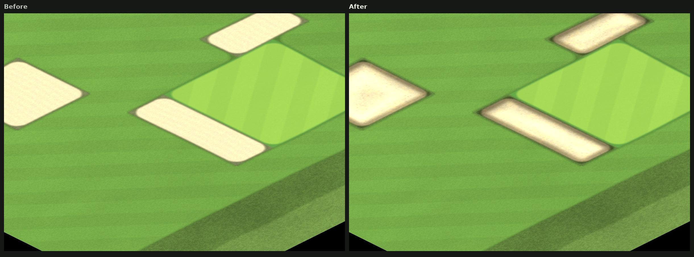

# Course Surface

> The course ground is drawn as one continuous, shader-based landscape, with mower passes, collars, raked bunker bowls, moving water and painted tree grounds, instead of per-tile sprites.

**Source:** `scripts/terrain/course_surface.gd` (data and palette textures, `PALETTE_KEYS`, `palette_key()`, `map_color()`, upload coalescing), `shaders/course_surface.gdshader` (`surface()`, `edge_between()`, `inset_tile()`, `bunker_rim()`, `bunker_lip()`, `bunker_bowl()`, `water_depth()`, `same_water_body()`, `stream_bank_border()`, `tree_ground()`, `link_distance()`), `shaders/foliage_breeze.gdshader`, `scripts/terrain/terrain_grid.gd` (`grid_width`, `refresh_all_overlays()`)
**Tests:** `tests/unit/test_course_surface.gd`, `tests/unit/test_new_terrain_types.gd`

---

## Plain English

The course is no longer a grid of coloured squares. The ground is one connected landscape:

- **Turf** has diagonal mower passes. Putting greens have fine turf and a collar around them.
- **Bunkers** are a raked sand bowl sunk into the turf: a grass lip around the pit, one side of the floor in that lip's shade and the other in sun, arcs of raking, and the sand's own grain. Pot Bunkers are a separate tile with a stacked-turf face.
- **Water** moves gently, and deepens only where a pond's tiles run together at one elevation level: the shallows run clear over a bright bed, the middle of a pond goes dark and still, and the water above and below a step is a shallow shelf on either side of it.
- **Trees** each have a ground painted under them, such as leaf litter, pine needles or sand.

The simulation still uses the same tile grid (128 × 128 by default). This is a rendering change only. Camera controls, saved courses, hazards and shot logic all keep their existing coordinates. Soft edge blends are drawn for looks and do not change a ball's lie.

Desktop and web use the same shader. The terrain data is stored in a small texture, one pixel per tile. Theme colours live in a separate palette texture, with one texel per terrain type. A new terrain type therefore needs only a new palette key.

Some terrain types share looks. Rocks, Small Boulders and Large Boulders use one stone base colour, with three stone sizes. The twelve woodland types all paint ground from the same trees palette entry.

The same palette colours the two small maps of the course: the minimap and the
Course Map both ask `CourseSurface.map_color(type)` for each tile, so the ground
reads identically at every size, and a theme change (or a colourblind mode)
repaints all three together. See [Course Map](course-map.md).

### Paintable features

| Tile | Look |
| --- | --- |
| Bunker | A raked sand bowl in a grass lip. The lips of neighbouring bunkers open into each other, so a run of tiles is one pit with one lip around the outside of it; the lip's shade falls on the near side of the floor and the sun on the far wall, the sand sags in the middle, raking arcs follow the lip, and drifts of drier grains lie over the floor. |
| Firm Fairway | Fairway mower passes, paler, with sun-dried straw patches. It reads as faster, drier turf inside a normal fairway. |
| Deep Rough | Long standing blades, darker clumps and pale seed-head dots. |
| Rocks | Gravel field. |
| Small Boulders | Pebbles, with the odd larger stone. |
| Large Boulders | Big stones that stand up out of the ground, with a contact shadow. |
| Brush | Sparse shrubs with occasional blossoms. |
| Waste Bunker | Coarse sand with pebbles and wiregrass tufts. It breaks up raggedly into the surrounding turf. |
| Pot Bunker | A turf lip, a stacked-turf wall and a sand floor. The lip is the same rough turf a stream's banks keep (`bank_turf()`), so a pot sunk in Rough or beside a stream shows the same grass rather than a square of its neighbour's. |
| Stream | A narrow channel cut through the same rough turf a pot bunker's lip keeps (`bank_turf()`), with a muddy, pebbled margin and soft crests drifting downstream. The bank opens at the channel mouth so its water joins a pond. Its grass keeps its own turf and is edged with a narrow dark border — the same width as a Bunker's grass lip — wherever the tile meets different terrain, instead of fading into it; Water, Rough and Pot Bunker meet it with no border. |

Rocks, boulders, brush and waste bunkers are **inset terrain**. They are drawn over whatever turf surrounds them, so a patch has a natural outline rather than a square one.

### Trees

Every tree is a painted tile, including the generic Trees tile and its species. Each species paints one of six grounds:

| Ground | Species | Look |
| --- | --- | --- |
| Leaf litter | Trees, Oak, Maple, Birch, Shrub | Shaded earth with fallen leaves and twigs |
| Pine needles | Pine | Rust-brown needle bed, with cones |
| Bare sand | Cactus, Palm, Dead Tree | Waste-bunker sand with grit and pebbles |
| Waterlogged silt | Cattails | Wet mud with reed litter |
| Acid peat | Heather | Dark peat over stone, with purple heather |
| Dry straw | Fescue | Uncut firm-fairway sward gone to straw |

A lone tree is a patch around its trunk, and a grove is one unbroken floor.

`TreeOverlay` paints only the sprite: a tree casts no contact shadow of its own. The ground its tile paints already shades it, and a flattened grey ellipse under every trunk darkened that art and read as a smudge rather than a shadow.

---

## Algorithm

### 1. Data flow

`CourseSurface` listens for local tile changes and coalesces GPU uploads to one per frame. Quiet terrain generation rebuilds explicitly through `TerrainGrid.refresh_all_overlays()`. Deserializing terrain or elevation data, and successful load events, rebuild the data. Theme changes replace only the palette.

### 2. Edges between materials

Material boundaries sit on the shared tile edges, inside a narrow anti-aliased band (`AA` = 0.04 tiles half-width). They do not blend across the tile centre. This keeps each tile's square footprint, so an isolated tile does not bulge into a rounded blob.

`edge_between(self, other)` decides whether a boundary is drawn:

- Unbordered grass tiles (native grass, fairway, firm fairway, rough and heavy rough) next to an inset tile (Pot Bunker or Stream) draw **no** boundary band; both Pot Bunker and Stream keep their own rough turf (`bank_turf()`, `keeps_own_turf()`), and show that same grass inside a neighbour's band instead of the neighbour's own.
- A Bunker's lip is painted by `surface()` at the open edges, on the same `FRINGE` band and `EDGE_LIP_LO` / `EDGE_LIP_HI` coverage ramp every other bordered tile copies. `bunker_bowl()` then shades the pit inside that band, so the bowl never spills into a neighbour's border.
- A stream's grass bank keeps its own turf and draws a narrow, dark border along open edges instead of blending across them (`stream_bank_border()`), using the shared `FRINGE` band and `EDGE_LIP_LO` / `EDGE_LIP_HI` coverage thresholds so it matches the Bunker's grass lip. Water, Rough and Pot Bunker meet the bank with no border at all (`stream_borders()`); everywhere else the border follows each edge's boundary strength, thinning out through a channel mouth and staying inside the tile.
- Deep Rough, Waste Bunker, Brush, Rocks, Small Boulders, Large Boulders, Wild Flowers (`FLOWER_BED`) and all twelve woodland tiles (`TREES` and `OAK`..`HEATHER`) each fill the full tile with a distinct procedural texture (`stony_surface()`, `brush_surface()`, `flower_bed_surface()`, `tree_ground()`, and the `surface()` branches for Deep Rough and Waste Bunker) and keep their own `boundary_class(id) == id`. Connected tiles of the same type merge seamlessly across shared edges, while edges shared with any different terrain tile type draw that tile's own distinct border (`tile_border()`) across the exact same `FRINGE` / `EDGE_LIP_LO`..`EDGE_LIP_HI` coverage ramp as the Bunker's lip instead of blending.
- Streams and ponds stay linked as wet terrain but use separate boundary classes. A bank marks where pond water meets the stream's rough turf, while the widening channel mouth cuts an opening so the water connects continuously.

### 3. Bunkers

A standard Bunker is drawn as a sand bowl sunk into its lip (`bunker_rim()`, `bunker_lip()`, `bunker_bowl()`), which is what gives the tile its depth. All of it is measured from `rim`: the distance, in tiles, to the edges the tile shares with terrain other than Bunker. Two Bunker tiles side by side are therefore one floor, and a run of them is one pit with one lip around the outside, its corners rounded by a smooth minimum.

| Cue | What it does |
| --- | --- |
| The lip's shade | The rim is re-measured a step toward the sun (`GROUND_LIGHT * BUNKER_SUN_STEP`). Where the sand's step toward the light still has a wall to clear, it is lit; where the lip stands between it and the sun, it lies in that lip's shade. This asymmetry — one dark side of the pit and one lit — is the depth cue, and it needs no per-tile depth data at all. |
| The sag | The middle of the pit is its lowest ground, so the sand loses a little light there and holds more up the slopes. |
| Contact shadow | The last stretch of sand before the lip is the darkest in the pit, as a falloff rather than a line, so the pit keeps a crisp edge at any zoom without a drawn rim resting on the sand. |
| Rake arcs | `sin(rim * BUNKER_RAKE_ARCS)` rakes the floor in arcs that follow the lip, with a noise offset so the hand wavers, and a finer comb across them. |
| Sand | `surface()` paints the sand's warmth and drift; the bowl adds a cool cast toward the walls, a pale skim of drier grains and a scatter of darker grit — all in world coordinates, so moving the camera does not move the sand. |
| The lip | `lip_turf()` — the rough turf a stream's bank keeps, settled toward the dark olive `BUNKER_LIP_TURF` the bordered tiles draw their own borders in — with a shaded inner face and a lit crest. |

The Bunker keeps its border: `surface()` mixes the lip grass in across the same coverage band as every other bordered tile, so a Bunker against fairway, rough or green frames its open edges with its own grass exactly as the bordered tiles do.

*The same bunkers before and after: flat pale sand, then a raked bowl with a grass lip, one side of the floor in that lip's shade and the other in sun.*

### 4. Pot bunkers and streams

Pot bunkers and streams use `link_distance()`, which measures the distance to a skeleton line joining the tile centre to each linked neighbour. Pots link to neighbouring pot tiles, and streams link to neighbouring stream or pond tiles. A tile with one horizontal and one vertical link becomes a quarter arc, so stepped lines of tiles read as smooth curves. Runs meet with a smooth minimum.

- A pot's floor is offset toward the viewer, which exposes its far wall. Its lip is the rough turf a stream's banks keep (`bank_turf()`): the pot is cut into that grass, so a pot sunk in Rough, or beside a stream, blends into it, and its apron is never another terrain's grass.
- A stream is a channel with a muddy margin and crests that drift downstream over time. The Stream tool paints 4-connected strokes (`TerrainBrush.centers_4_connected()`), because channels only join edge-adjacent tiles.
- The stream's grass bank is painted under the channel and its mud, by the same `bank_turf()` a pot bunker's lip uses, so the two tiles always show the same grass. It is then edged with the border above, so a stream cutting through a fairway reads as a crisply bordered ribbon rather than a soft stain on the turf. The border lies under the mud and the water, so neither the channel nor its margin is ever crossed by it, and Water, Rough and Pot Bunker are met without one.

### 5. Water

A pond is drawn as a bed under a column of water rather than a flat sheet of colour. The floor is painted first — sand, silt, gravel, ripple marks and weed — and the water above takes the light out of it in proportion to the depth, so the shallows run clear over a bright, detailed bed and the middle of a pond goes dark and still, with nothing to see but the surface. A stream's channel reuses the same bed and the same absorption (`RIVER_ABSORB`), which is why a burn reads as the same water as the pond it empties into.

Depth needs no stored data. `water_depth()` takes the Euclidean distance, in tiles, from the pixel to the nearest tile that is not part of the pixel's own body of water, so the shallows follow the shoreline in smooth rings instead of square steps, a narrow arm stays shallow along its whole length, and a pond wider than `WATER_MAX_DEPTH` simply stops deepening.

What counts as the same body is the whole point:

- A body is the run of **Water** tiles that touch edge to edge **at one elevation level**, read from the surface data's own elevation channel (`tile_data_at()`, `tile_level()`, `WATER_LEVEL_TOLERANCE`). Water only gets deeper where it is connected together at a single level.
- Water poured over a step is two bodies. The far side of the step is the near side's bank, so the level break runs off into shallows on both sides instead of the depth carrying the hillside's fall across it — a pond on a slope is a terrace of shallow shelves, one per level, not one sheet of deep water wrapped over the slope.
- `Stream` is not pond water: it draws its own channel (`inset_tile()`), and the channel mouth is what joins the two.
- Tiles off the course are never water, so a pond ends at the property line instead of reading as bottomless at the rim of the map.

The waterline is measured from the same depth. On a pond tile, wherever the water runs out — against a bank, and at the foot of a step between two levels of the same pond — the last of the floor is wet and darkened, with the light the surface throws back along it (`water_surface()`). A pixel painted outside a pond tile, such as a stream mouth blending into the pond or the band a bank draws over its own edge, has no body depth to read, so it keeps the material edge alone.

### 6. Turf and water animation

Noise and mower passes use world coordinates, and so do a Bunker's raking and its drifts of sand: moving or zooming the camera does not move the pattern. Water animates from GPU time and needs no per-tile script updates. Standard Bunkers always use the same raked-bowl treatment, whatever the theme; Pot Bunkers draw their own stacked-turf lip. Greens blend into the theme's fringe colour at their edges.

### 7. Foliage

Foliage uses one shared vertex shader. Each tree sways with a phase set by its world position, and movement falls off toward the base of the trunk. Cacti and dead trees do not move.

### 8. Layering and lighting

`EntityLayer` sits at Z = 2. Its shadows stay above the ground and below the sprites. Elevation lighting is separate, and contour lines appear only while the elevation tool is active. Continuous light and smooth ambient occlusion avoid rectangular bands from the low-resolution heightmap.

Tree sprites use the shared heightfield intersection in `terrain_heightfield.gdshaderinc` for per-pixel terrain occlusion. A higher tile in front of a tree hides the covered trunk or canopy pixels; it does not erase the whole tree or clip a crown that remains in front of the terrain. Ordinary Y-sort still resolves trees against other standing entities.

### 9. Quick Start

Quick Start paints the course it wants directly. A wood is a tile, so clearing a spot for a hole is one tile change, with no entity removal. This avoids leaving holes in fairways and greens.

---

## Tuning Levers

| Setting | Location | Current value | Effect |
| --- | --- | --- | --- |
| Grid size | `terrain_grid.gd` `grid_width` | `128` | Size of the tile grid |
| Boundary band | `course_surface.gdshader` `AA` | `0.04` tiles | Sharpness of material edges |
| Edge treatment band | `course_surface.gdshader` `FRINGE` | `0.30` tiles | How far inset edges blend |
| Edge-treatment fade | `course_surface.gdshader` `EDGE_LIP_LO`, `EDGE_LIP_HI` | `0.50` and `0.68` coverage | Where the Bunker's grass lip, and the stream border that copies its size, fade in |
| Bunker lip width | `course_surface.gdshader` `bunker_lip()`, `BUNKER_LIP_FOOT` | The shared `FRINGE` band; the sand starts `0.12` tiles in | How wide a Bunker's grass lip is, and where its sand begins |
| Bunker bowl depth | `course_surface.gdshader` `BUNKER_SUN_STEP`, `bunker_bowl()` | `0.14` tiles toward the sun | How far the near lip's shade reaches across the floor — the whole sense of depth |
| Bunker raking | `course_surface.gdshader` `BUNKER_RAKE_ARCS` | `11` arcs across the floor | Spacing of the rake marks |
| Bunker lip turf | `course_surface.gdshader` `BUNKER_LIP_TURF`, `lip_turf()` | `vec3(0.35, 0.40, 0.24)`, rough turf settled `0.20` toward it | Colour of a Bunker's lip, matched to the bordered tiles' own borders |
| Stream bank border | `course_surface.gdshader` `stream_bank_border()`, `stream_borders()` | The Bunker lip's band; none against Water, Rough, Pot Bunker | Size of the border on a stream's grass, and which neighbours get one |
| Stream channel width | `inset_tile()` | Half-width about `0.25` tiles | Width of streams |
| Stream bank and pot lip turf | `course_surface.gdshader` `bank_turf()` | Rough's palette colour plus its tuft variation | Colour and texture of a stream's grass bank and a pot bunker's lip |
| Waste margin raggedness | `inset_tile()` | Edge noise, up to about `0.2` tiles | How ragged sand edges look |
| Stone size and density | `rocks_radius()`, `rocks_present_threshold()` | See the table in the source | How many stones and how big |
| Boulder height | `rocks_tallness()` | `1.7` for Large Boulders | How far boulders stand up |
| Water body | `course_surface.gdshader` `same_water_body()`, `WATER_LEVEL_TOLERANCE` | Water tiles at one elevation level, joined edge to edge; `0.5` levels of tolerance | What counts as one pond. Water deepens only inside a body: tiles under half a level apart are the same water, and the next level up is a bank |
| Water depth | `course_surface.gdshader` `WATER_MAX_DEPTH`, `WATER_ABSORB`, `WATER_DETAIL_ABSORB` | `3.2` tiles, `0.95`, `2.4` | Deepest water measured, how fast the column darkens with depth, and how fast the floor's fine detail is lost |
| Water animation | `course_surface.gdshader` | GPU time | Speed of water movement |
| Foliage breeze | `foliage_breeze.gdshader` | Small amplitude | Strength of canopy motion |
| Palette | `course_surface.gd` `PALETTE_KEYS` | One key per terrain type | Colour of each terrain type |

---

## Related

- [Terrain Types](terrain-types.md) lists every tile type and its look.
- [Course Architecture](course-character.md) covers landforms and facility drawing.
- [Builder Tools](builder-and-review.md) covers the paint tools.
